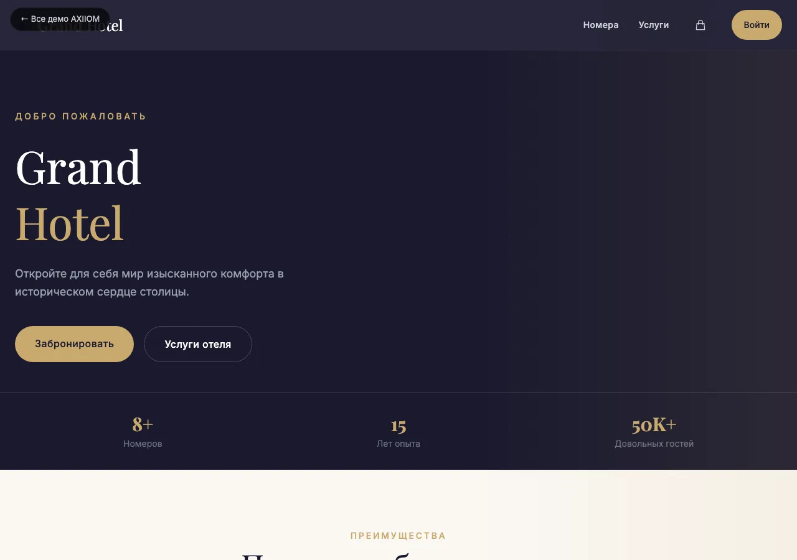
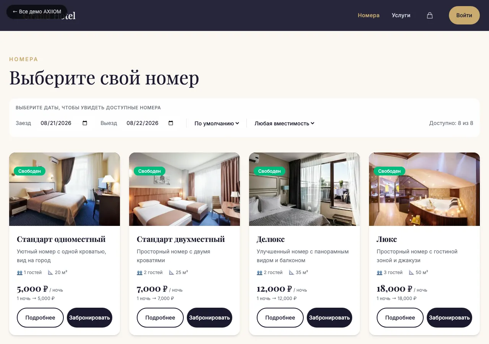

# Grand Hotel — демо системы бронирования номеров

> Демо-версия отельной платформы: каталог номеров, онлайн-бронирование, корзина,
> личный кабинет и админка. Разработка **[AXIIOM](https://axiiom.ru)**.

[](https://bestdeejay-design.github.io/booking/)
[](https://bestdeejay-design.github.io/booking/)

**Живой демо:** https://bestdeejay-design.github.io/booking/

---

## Что внутри

- **Каталог номеров** — карточки с ценой, вместимостью, площадью, превью.
- **Бронирование** — выбор дат, проверка доступности, добавление в корзину.
- **Корзина и оплата** — Stripe (test mode), итог по ночам.
- **Личный кабинет** — история, профиль (Firebase Auth).
- **Админка** — управление номерами и услугами, настройки отеля.
- **Контент-страницы** — главная, услуги отеля, страница номера.

## Стек

- **React 19** + **Vite 8** (HMR, production build)
- **React Router 7** (HashRouter — совместим с GitHub Pages)
- **Tailwind CSS 4** (CSS-first конфиг, дизайн-токены в `@theme`)
- **Firebase** (Auth, Firestore) — данные сидируются при первом запуске
- **Stripe** (оплата, test mode)
- **date-fns**, **react-datepicker**, **react-hot-toast**

## Запуск локально

```bash
npm install
npm run dev      # дев-сервер на http://localhost:5173
npm run build    # production-сборка в dist/
npm run preview  # предпросмотр сборки
```

> Демо работает и без настроенного Firebase: при ошибке подключения
> подставляются локальные seed-данные (номера и услуги из `DataContext.jsx`).

### Сборка под GitHub Pages

```bash
npm run deploy   # сборка + публикация ветки gh-pages через gh-pages
```

Базовый путь задан в `vite.config.js` (`base: '/booking/'`).

## Структура

```
src/
  components/   # Navbar, Footer, Layout, RoomCard, ServiceCard, защищённые роуты
  contexts/     # AuthContext, CartContext, DataContext (Firebase + seed-фолбэк)
  pages/        # Home, Rooms, RoomDetail, Services, Cart, Payment, Login, Dashboard, Admin
  config/       # firebase.js
public/
  images/       # превью номеров и услуг (webp)
  icons/        # PWA-иконки
  manifest.webmanifest, robots.txt, sitemap.xml, 404.html, .well-known/security.txt
docs/           # архитектура, модель данных, фичи, план реализации
```

## Документация проекта

- `docs/architecture.md` — архитектура приложения
- `docs/data-model.md` — модель данных (rooms, services, settings)
- `docs/features.md` — описание функций
- `docs/implementation-plan.md` — план реализации

## Статус

Демо-версия. Часть каталога демо-проектов AXIIOM (дорожная карта — `repo-catalog`).
